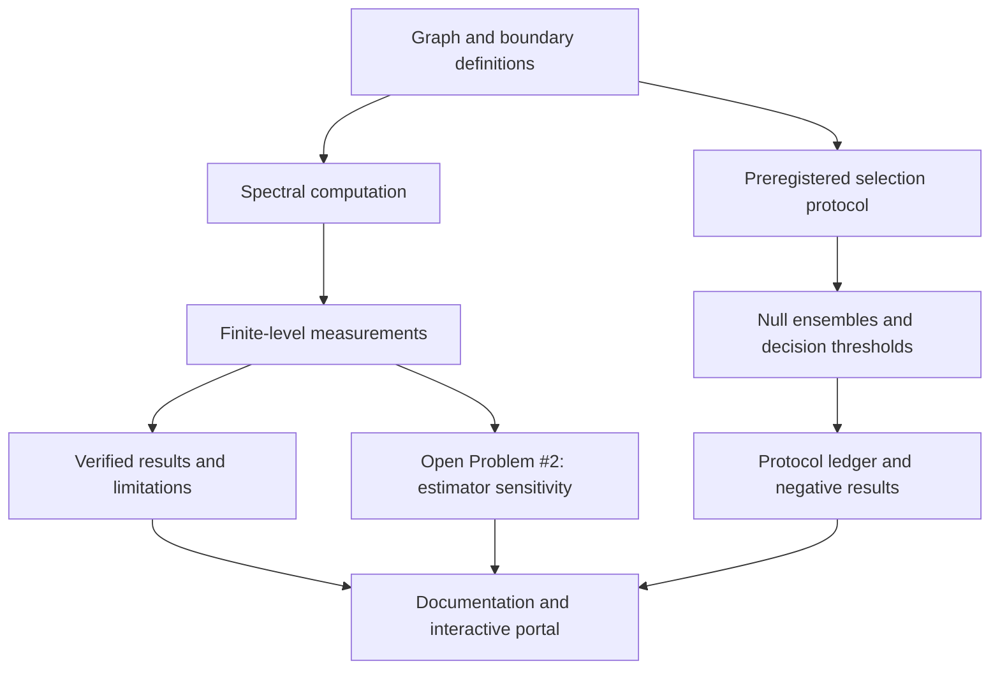

# Phi-Genesis Architecture

**Purpose:** describe the components and evidence flow of the spectral audit, using the same article layout and navigation role as the Architecture section in UltraCore-RFT.

## System overview

Phi-Genesis combines graph construction, spectral computation, boundary-condition experiments, preregistered selection tests, and provenance records. The site is a navigation and explanation layer; code, committed inputs, test outputs, and versioned protocols remain authoritative.

## Components

| Component | Role | Evidence boundary |
|---|---|---|
| Graph Laplacian and decimation | Build finite Sierpiński-gasket operators and examine factor-five structure | Corner-degree-2 boundary defects require the documented correction |
| Spectral counting | Compute eigenvalue counts and estimate spectral exponents | Finite-window fits are sensitive to estimator and window choice |
| Boundary twists | Evaluate Möbius / \(\pi\)-flux and generation-twist configurations | A spectral gap does not establish target-index selection |
| Selection protocol | Run preregistered searches against fixed null pools and thresholds | Results apply to tested families and protocol versions |
| Provenance ledger | Record configurations, outcomes, and post-hoc diagnostics | Historical search counts may be lower bounds where sweeps were not fully recorded |
| Documentation and interactive portal | Expose methods, results, history, and code links | Presentation is not an independent verification layer |

## Computational detail

See [Computational Architecture](computational-architecture.md) for the module-by-module map, [Reproducibility](reproducibility.md) for clean-checkout commands, and [Data & Provenance](data-and-provenance.md) for the source-of-truth hierarchy.

## Scientific boundary

The target indices \(\{1,12,17,40\}\) have not been independently derived from a spectral invariant. The relation \(m=A n\) is a fit, not an independent prediction. The claimed \(\eta\)-invariant value \(-4\) was not reproduced in the documented tests. Open Problem #2 remains open. None of these statuses is changed by the documentation architecture or a successful CI run.
